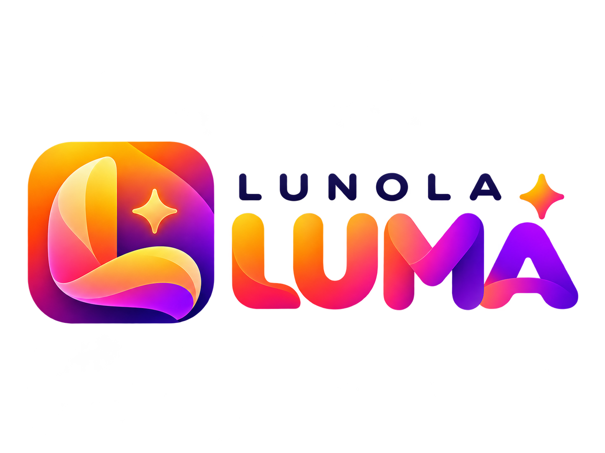
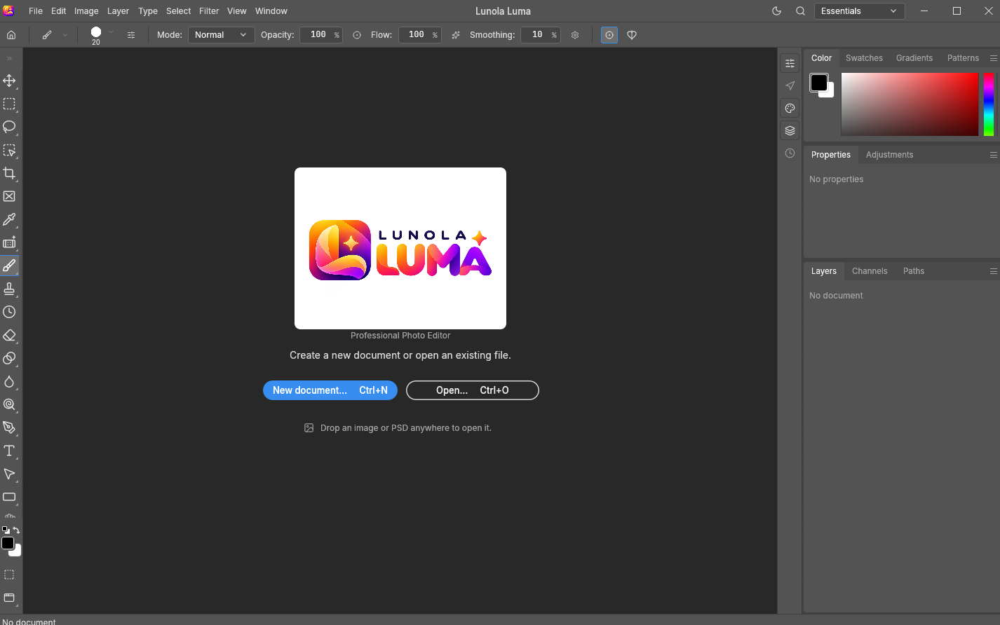

  

<h1 align="center">Lunola Luma</h1>

  <strong>Make the image. Keep every layer.</strong> 
  A professional photo editor for thoughtful, detailed image work. 
  <em>By Pujo Setyo</em>

  <a href="https://github.com/pujosety/Lunola-Luma/releases/tag/v0.7.0"><strong>⬇ Get Lunola Luma</strong></a>
  &nbsp;·&nbsp;
  <a href="docs/getting-started.md">Getting started</a>
  &nbsp;·&nbsp;
  <a href="docs/">Documentation</a>
  &nbsp;·&nbsp;
  <a href="ROADMAP.md">Roadmap</a>

  
  
  

  

> **Download:** Lunola Luma v0.7.0 preview is published. Windows installers are unsigned; release notes list the missing platforms and test limitation.

## An editor built around the way you work

Lunola Luma brings a native, GPU-accelerated canvas together with the precision tools of a layer-based editor. Make a change, refine it, revisit it later—without flattening your ideas along the way.

| ✦ Shape the image | ✦ Keep edits flexible | ✦ Finish with control |
|---|---|---|
| Brushes, selections, paths, vector shapes and editable type. | Groups, masks, adjustment layers, smart objects and live filters. | Color-managed documents, detailed export controls and familiar keyboard-driven workflows. |

## A closer look

- **Layered editing:** groups, clipping masks, pixel and vector masks, fill and adjustment layers, smart objects, blend modes and layer styles.
- **A responsive canvas:** native Rust interface with a `wgpu` renderer and GPU-assisted composition.
- **Tools for fine work:** a pressure-aware brush engine, selection and mask tools, vector paths, shape layers and on-canvas typography.
- **Color with intention:** RGB, grayscale, CMYK and Lab documents at 8-, 16- and 32-bit depths, with ICC profiles, soft proofing and gamut warnings.
- **Repeatable workflows:** batch operations and a scriptable command engine for routine edits.

## Open the files you already have

**Layered documents:** PSD and PSB, layered TIFF, OpenRaster, Krita `.kra`/`.krz` (read-only import), and Lunola Luma's native `.pcraft` format.

**Images:** PNG, JPEG, TIFF, WebP, GIF, BMP, TGA, ICO, QOI, PNM, OpenEXR and Radiance HDR. FITS is supported for astronomy images. HEIF/HEIC and several additional formats have read-only or build-dependent support.

Read/write details and limitations are listed in the [format capability matrix](crates/codecs/README.md#capability-matrix-default-build).

## Get the preview

[**Visit the official Releases page →**](https://github.com/pujosety/Lunola-Luma/releases/tag/v0.7.0)

Version 0.7.0 is a published preview. GitHub lists 22 assets: 19 verified CI packages, `SHA256SUMS.txt`, and two generated source archives. Packages cover Windows x86/x64/ARM64, Linux x86_64/aarch64, Flatpak, and FreeBSD; macOS, Linux riscv64, and WebAssembly packages are absent. Windows MSI and portable EXE files are unsigned. The known UI test result is 2,184 passed, 1 failed, 10 ignored (duplicate Czech `"Tool"` catalog key). Review the release notes and checksums before installing.

## Build from source

1. Install the Rust toolchain and the platform prerequisites in the [build guide](docs/getting-started.md).
2. Clone this repository and follow the tested setup steps in that guide.
3. Use the [development reference](docs/development.md) for tests, fonts, environment settings and troubleshooting.

The desktop, command-line and WebAssembly targets share the same editing engine. Their internal package names are retained for compatibility; product-facing text and artwork use **Lunola Luma**.

## Project status

Lunola Luma is actively developed and remains an early-stage editor—not a drop-in replacement for every professional workflow. Some tools, typography workflows and integrations are still in progress. The [roadmap](ROADMAP.md), [feature assessment](docs/target-app-parity.md) and [known gaps](docs/gaps.md) distinguish complete, partial and planned work.

## Project links

- [Documentation index](docs/README.md)
- [Contribution guide](docs/contributing.md)
- [Security policy](SECURITY.md)
- [Release notes and package status](releases/README.md)
- [Web preview hosting](packaging/web/README.md)

## Credits and licenses

Lunola Luma is maintained by **Pujo Setyo**. Source-code licenses, required notices and third-party asset credits are preserved in [NOTICE](NOTICE), [ATTRIBUTION.md](ATTRIBUTION.md), and the individual license files. Lunola Luma marks are supplied by the project owner under a separate mark license: [brand license](brand/lunola-luma/LICENSE-brand.txt).

The software is independent and is not affiliated with, sponsored by, or endorsed by Adobe Inc. Product and file-format names are used only to describe compatible workflows. See [legal notices](NOTICE) for full credits.
